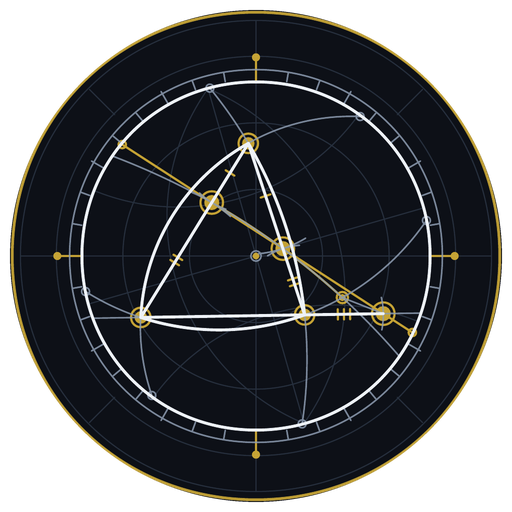

GEOMETOR • menelaus
===================

**Visit the Online Archive:** https://geometor.github.io/menelaus/

**Menelaus of Alexandria • Spherics • semantic digital archive**

Mission
-------

``geometor/menelaus`` is part of the interconnected `GEOMETOR <https://geometor.com>`_ semantic digital archive. It preserves Menelaus of Alexandria's landmark treatise *Spherics* (*Sphaericorum Libri III*), which established intrinsic spherical trigonometry and the foundational transversal theorem uniting planar and spherical triangles. Through addressable semantic units, calibrated theme-adaptive vector diagrams, primary-source folio provenance, and exact SymPy symbolic demonstrations, Menelaus's geometry connects ancient astronomy directly to modern projective geometry across the GEOMETOR corpus.

Books in This Archive
---------------------

- `Spherics <https://geometor.github.io/menelaus/sphaerica/>`_ — Menelai Sphaericorum Libri III, establishing intrinsic spherical geometry, the Planar & Spherical Menelaus Transversal Theorems, and projective Ceva–Menelaus duality (ed. Edmond Halley, 1758).

Symbolic Geometry Capabilities
~~~~~~~~~~~~~~~~~~~~~~~~~~~~~~

- **Planar Transversal Theorem** (``geometor.menelaus.planar_transversal``): Exact SymPy construction of the Menelaus configuration, harmonic cross-ratio pencils, and Converse collinearity lemmas (Pascal's Hexagram, Monge's Exsimilicenters).
- **Spherical Geometry & Duality** (``geometor.menelaus.spherical`` & ``geometor.menelaus.duality_ceva``): Intrinsic 3D unit-sphere models, spherical excess, signed sine and Ptolemaic chord ratios, and complete quadrangle harmonic conjugation.

Repository Contents
-------------------

- ``docsrc/`` — RST documentation source, 4-track study codex, and Sphinx docs compiled by `PHOTON publish <https://github.com/photon-platform/publish>`_.
- ``resources/`` — Primary-source folios, Bodleian manuscript facsimiles, and apparatus registries.
- ``src/geometor/menelaus/`` — Exact SymPy models for planar transversals, spherical trigonometry, and Ceva–Menelaus duality.

Local Build & Verification
--------------------------

.. code-block:: bash

   publish build
   uv run --no-sync pytest

Part of the GEOMETOR Knowledge Archive
--------------------------------------

Explore all **74 Book Codices** and **11 Mathematical Catalogs** at https://geometor.com/books/.
