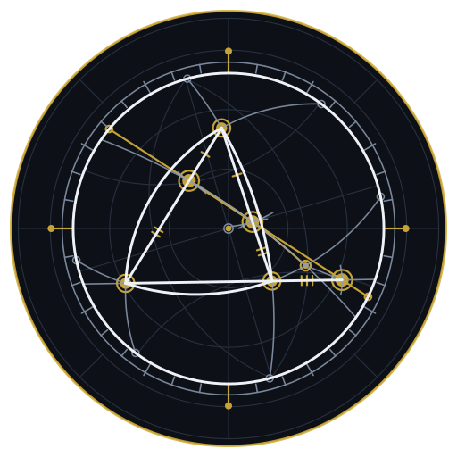

:site_title: Menelaus of Alexandria

.. _menelaus-home:

.. container:: author-overline

   semantic digital archive • the works of

======================
Menelaus of Alexandria
======================

:person:`Menelaus of Alexandria <menelaus>` (c. 70–140 CE) founded intrinsic spherical geometry by treating the spherical triangle—bounded by arcs of great circles—as a primary object in its own right. His three-book *Sphaerica* proved that the angle sum of a spherical triangle always exceeds two right angles, established the **Rule of Six Quantities** (Menelaus's Theorem) that powered astronomy from Ptolemy's *Almagest* onward, and anticipated the projective invariance of the cross-ratio by sixteen centuries.

Books in This Collection
------------------------

.. container:: home-book-hero

   .. container:: home-book-thumb

      .. image:: _static/figures/spherical-menelaus-3d.svg
         :alt: Menelaus's Spherical Theorem (Rule of Six Quantities) on a great-circle triangle
         :target: sphaerica/index.html

   .. container:: home-book-body

      .. rubric:: Three-Witness Critical Edition · 1758 / 1898 / 1902 · Books I–III · 31 Atomic Sections

      **Sphaerica (Spherical Geometry)** — Reconstructed across **four synchronized tracks** (*English · Latin · Summary · Notes*) and **1,044 linked primary-source folios** from Edmond Halley's 1758 Oxford Latin edition, Axel Björnbo's 1902 study of Abū Naṣr Manṣūr's Arabic witness, and J. L. Heiberg's 1898 Greek text of Ptolemy's *Almagest* I.13.

      .. container:: home-actions

         * :doc:`Open the Sphaerica → <sphaerica/index>`
         * :doc:`Book I: Spherical Triangles → <sphaerica/liber_i/index>`
         * :doc:`Book III, Prop. 1 (Menelaus's Theorem) → <sphaerica/liber_iii/prop_01/index>`
         * :doc:`Book III, Prop. 3 (Cross-Ratio) → <sphaerica/liber_iii/prop_03/index>`

Key Features
------------

.. container:: home-feature-grid

   .. container:: home-feature-card

      **1,044 Three-Witness Folio Scans**

      Every definition, lemma, and proposition links monotonically to 300-DPI archival scans of Halley (1758), Björnbo (1902), and Heiberg's *Syntaxis* (1898).

   .. container:: home-feature-card

      **Ten Calibrated Spherical & Projective Plates**

      Interactive theme-adaptive ``.euclid-graphic`` SVGs illustrate spherical excess, the Rule of Six Quantities, spherical cross-ratio pencils, Desargues's axis, Ceva polarity, and Pascal's hexagram.

   .. container:: home-feature-card

      **Exact Symbolic Spherical Verification**

      Verify spherical transversals, polar triangles, cross-ratio invariance, and Rational Trigonometry analogues with zero floating-point drift in :doc:`Demos <demos/index>` and ``geometor.menelaus``.

Reference & Project
-------------------

.. container:: home-columns

   .. container:: home-col

      .. rubric:: Scholarly Apparatus

      * :doc:`People <sphaerica/people/index>` — Profiles of Menelaus, Ptolemy, Abū Naṣr Manṣūr, Edmond Halley, Axel Björnbo, and J. L. Heiberg
      * :doc:`Bibliography <sphaerica/bibliography>` — Manuscript traditions, 1758 Oxford Latin edition, and modern critical studies
      * :doc:`Concordance <sphaerica/concordance>` — Halley (1758) ↔ Björnbo / Abū Naṣr proposition numbering cross-walk

   .. container:: home-col

      .. rubric:: About This Project

      * :doc:`About <about/index>` & :doc:`Using This Edition <usage/index>` — Editorial scope, four-track reading guide, and folio provenance
      * :doc:`Demos <demos/index>` & :doc:`Python Modules <modules/index>` — Symbolic spherical geometry verifiers and package reference
      * :doc:`Project Log <log/index>` — Scriptorium transcription notes and verification milestones

.. toctree::
   :hidden:
   :maxdepth: 2

   sphaerica/index
   sphaerica/people/index
   sphaerica/bibliography
   about/index
   usage/index
   demos/index
   log/index
   modules/index
